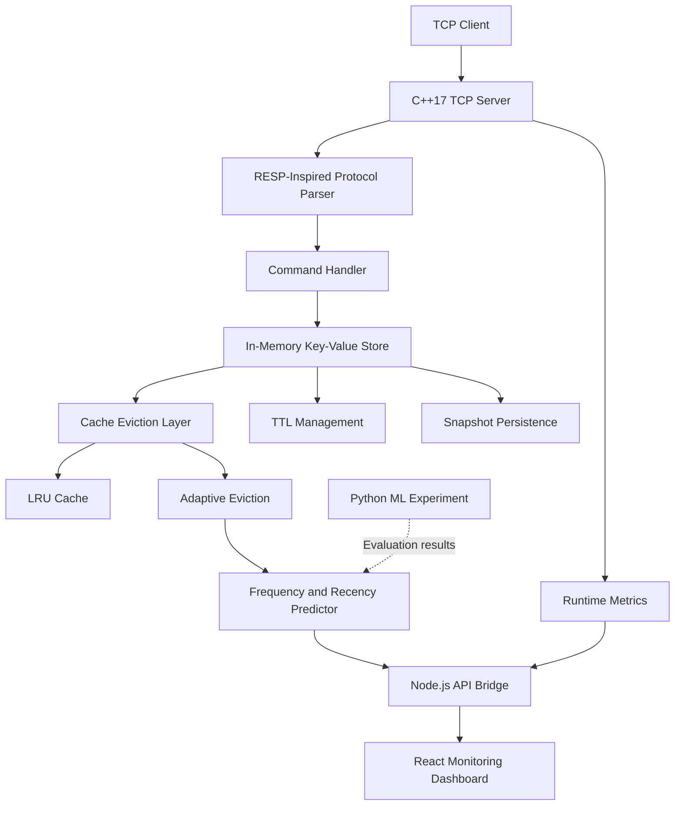

# NeuraCache

**An adaptive in-memory key-value database built with C++17, TCP networking, and workload-aware cache eviction.**

NeuraCache is a systems programming project that explores how cache eviction strategies, access-pattern prediction, persistence, and concurrency affect the performance of an in-memory database. It combines a lightweight C++ server with an experimental machine-learning pipeline and a React-based monitoring dashboard.

## Overview

Traditional Least Recently Used (LRU) caching evicts the least recently accessed item when capacity is reached. This can perform poorly on scan-heavy workloads, where a sequence of one-time accesses can displace frequently reused keys.

NeuraCache explores an alternative: combining access frequency and recency to estimate which keys are likely to remain useful. It also includes a separate machine-learning experiment to evaluate whether a learned access predictor can improve prediction accuracy on synthetic workloads.

The project is designed for exploring systems engineering concepts, not as a production-ready replacement for Redis.

## Architecture



The C++ server handles database operations and client connections. The monitoring dashboard communicates through a Node.js API bridge. The Python machine-learning experiment is separate from the core server, keeping the production prediction heuristic lightweight and independent of a Python runtime.

## Features

### Core database

- In-memory key-value storage
- Commands: `SET`, `GET`, `DEL`, `EXISTS`
- Expiration: `EXPIRE`, `TTL`
- Numeric operations: `INCR`, `DECR`
- Database inspection: `DBSIZE`, `INFO`
- Database clearing: `FLUSHDB`

### Networking and concurrency

- TCP server with a default port of `6379`
- Persistent client connections
- Concurrent client handling
- Request pipelining
- Fragmented request handling
- Partial response handling
- Graceful shutdown

### Adaptive cache eviction

NeuraCache combines access frequency and recency to estimate the usefulness of tracked keys.

The lightweight heuristic uses a weighted score:

\[
\text{Score} = 0.6 \times \text{Frequency}
+ 0.4 \times \text{Recency}
\]

The implementation exposes prediction-related commands:

- `PREDICT`
- `TOPPREDICT`
- `ANALYZE`

This heuristic is implemented in C++ and does not require a machine-learning runtime.

### Persistence

- Binary snapshot persistence
- Database restoration during startup
- Snapshot creation during shutdown
- Backup snapshot handling
- Preservation of remaining TTL information

### Runtime metrics

The `INFO` command exposes operational statistics, including:

- Total commands
- GET, SET, and DELETE operations
- Cache hits and misses
- Evictions
- Expired keys
- Server uptime

### Monitoring dashboard

The project includes a React and Vite dashboard, supported by a Node.js API bridge, for viewing:

- Server status and uptime
- Runtime statistics
- Cache hit rate
- GET, SET, and DELETE activity
- Evictions and expired keys
- Live command activity
- Prediction scores and tracked-key statistics

## Performance and Experiments

The following figures are the project's reported development benchmarks and synthetic-workload results. They are not universal performance guarantees.

### Throughput benchmarks

| Workload | Reported throughput |
|---|---:|
| GET | ~1.8M operations/sec |
| SET | ~250K operations/sec |
| Mixed workload | ~430K operations/sec |

Results depend on the hardware, compiler configuration, workload, concurrency, and benchmark methodology. Re-run the included benchmarks on your own machine before comparing these figures with other databases.

### Adaptive cache benchmark

Under the project's synthetic scan workload:

| Cache policy | Reported hit rate |
|---|---:|
| Traditional LRU | 0% |
| Adaptive cache | 33.3% |

The adaptive policy reduced cache misses from 1,500 to 1,000 in this particular experiment. This illustrates a potential advantage on scan-heavy workloads; it does not establish that adaptive eviction outperforms LRU on all workloads.

### Machine-learning experiment

A separate Python experiment evaluates logistic regression against a dummy baseline and the built-in heuristic using synthetic cache-access data.

| Predictor | Reported accuracy |
|---|---:|
| Dummy baseline | 66.75% |
| Built-in heuristic | 67.85% |
| Logistic regression | 74.00% |

Logistic regression improved accuracy by 7.25 percentage points over the baseline and 6.15 percentage points over the heuristic in this evaluation.

**Important:** These are results from controlled synthetic data. They should not be interpreted as accuracy on production traffic or evidence of improved end-to-end database throughput. The ML experiment is separate from the C++ server's built-in predictor.

## Technology Stack

| Component | Technologies |
|---|---|
| Core server | C++17 |
| Networking | TCP sockets, RESP-inspired protocol |
| Build system | CMake |
| Cache algorithms | LRU, adaptive frequency/recency scoring |
| Persistence | Binary snapshots |
| ML experiment | Python, NumPy, scikit-learn |
| API bridge | Node.js |
| Dashboard | React, Vite |
| Testing | CTest and C++ test executables |

## Project Structure

```text
NeuraCache/
├── benchmarks/
│   ├── benchmark.cpp
│   ├── concurrent_benchmark.cpp
│   └── adaptive_benchmark.cpp
├── docs/
│   └── architecture.md
├── frontend/
│   ├── server/
│   │   └── index.cjs
│   └── src/
├── ml/
│   ├── generate_dataset.py
│   ├── train_predictor.py
│   └── evaluate_predictors.py
├── src/
│   ├── ai/
│   ├── commands/
│   ├── eviction/
│   ├── metrics/
│   ├── persistence/
│   ├── protocol/
│   ├── server/
│   └── storage/
├── tests/
├── CMakeLists.txt
└── README.md
```

## Getting Started

### Prerequisites

- C++17-compatible compiler
- CMake
- macOS or Linux
- Node.js and npm for the dashboard
- Python 3 and pip for the optional ML experiment

### 1. Clone the repository

```bash
git clone https://github.com/Hellboyom/NeuraCache.git
cd NeuraCache
```

### 2. Build the C++ server

```bash
cmake -S . -B build
cmake --build build -j
```

### 3. Run the server

```bash
./build/neuracache
```

The server listens on `127.0.0.1:6379` by default.

In a second terminal, you can open a TCP connection using:

```bash
nc 127.0.0.1 6379
```

The server uses a RESP-inspired protocol. Use a compatible client or send commands in the protocol format expected by the implementation.

### 4. Run the tests

```bash
ctest --test-dir build --output-on-failure
```

The test suite covers database operations, command handling, protocol parsing, LRU behavior, adaptive caching, concurrency, persistence, and runtime metrics.

### 5. Start the monitoring dashboard

In a separate terminal:

```bash
cd frontend
npm install
```

Start the Node.js API bridge:

```bash
node server/index.cjs
```

Start the React development server in another terminal:

```bash
cd NeuraCache/frontend
npm run dev
```

Open the local development URL printed by Vite, typically `http://localhost:5173`. The API bridge uses port `3001` in the current project configuration.

### 6. Run the optional ML experiment

From the repository root:

```bash
python3 -m venv ml/.venv
source ml/.venv/bin/activate
python -m pip install numpy scikit-learn
python ml/generate_dataset.py
python ml/train_predictor.py
python ml/evaluate_predictors.py
```

Run the experiment independently of the C++ server. If your scripts or dependency versions change, update these instructions to match the tested workflow.

## Testing and Benchmarking

NeuraCache includes test and benchmark code under `tests/` and `benchmarks/`.

For meaningful performance comparisons, record:

- CPU and memory configuration
- Operating system and compiler version
- Build type and compiler flags
- Dataset size and access distribution
- Number of clients and concurrency level
- Warm-up period and measurement duration
- Whether persistence, logging, or dashboard processes were active

Use repeatable workloads and multiple runs when comparing eviction policies or throughput. Keep synthetic cache hit-rate experiments separate from server throughput benchmarks.

## Engineering Decisions

### Why C++17?

C++ provides direct control over data structures, memory usage, socket programming, and concurrency. It is a useful foundation for experimenting with performance-sensitive infrastructure.

### Why adaptive eviction?

Pure recency-based eviction can struggle when scans displace frequently reused data. Combining frequency and recency provides an alternative policy to evaluate against LRU under different access distributions.

### Why separate the ML experiment?

The Python experiment allows learned predictors to be evaluated without adding Python or a model-runtime dependency to the core C++ server. This preserves a lightweight built-in heuristic while allowing experimentation with alternative prediction methods.

## Current Limitations

NeuraCache is an experimental, single-node systems project. Current limitations include:

- Single-node architecture
- Thread-per-client networking model
- In-memory primary storage
- Snapshot-based rather than append-only-log persistence
- No distributed clustering
- No authentication
- Limited Redis command compatibility
- Experimental prediction methods evaluated on synthetic data

These boundaries are intentional for the current scope. The project should not be treated as a production-ready Redis replacement.

## Future Work

Potential improvements include:

- Benchmarking against additional eviction policies and established databases
- Evaluation using real-world cache-access traces
- More scalable networking and concurrency
- Additional protocol and command compatibility
- Append-only-log persistence and recovery testing
- Connection pooling and resource limits
- Distributed or sharded caching
- Reproducible benchmark reports and continuous integration

## Learning Outcomes

NeuraCache brings together systems programming, data structures, caching algorithms, networking, concurrency, persistence, performance measurement, and machine-learning experimentation.

The central goal is to investigate how workload-aware eviction and access prediction can influence cache behavior, while keeping the core implementation measurable and testable.

## License

No open-source license is specified in this repository at present. Unless you add a license file, reuse and redistribution are subject to the default copyright rules.
